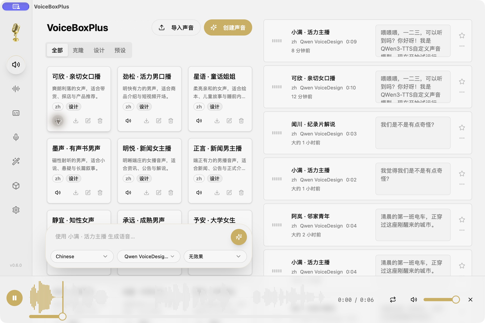
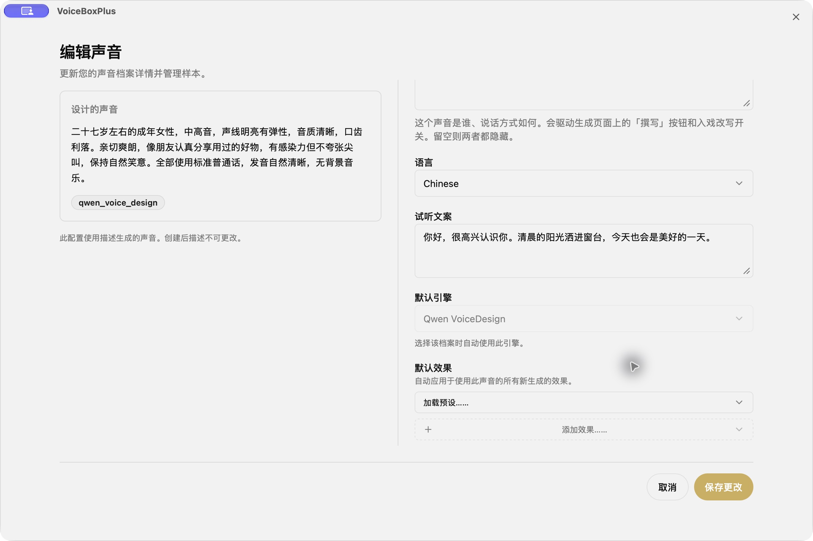
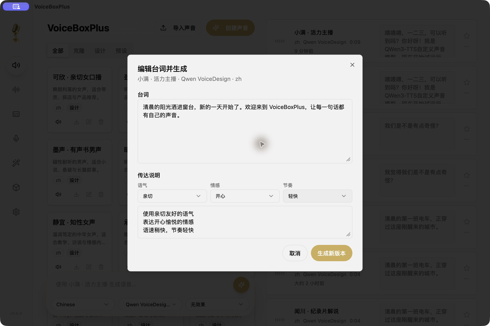

<!-- 重新定位二开项目，避免将上游下载、赞助和功能声明误认为本项目发布内容。 -->
# VoiceBoxPlus

**A local desktop voice studio for designing voices and producing expressive speech.**

English · [简体中文](README.zh-CN.md)

VoiceBoxPlus is an independent fork of [Voicebox](https://github.com/jamiepine/voicebox), created by Jamie Pine and the Voicebox contributors. It builds on their Tauri desktop app and Python backend, with a focus on Qwen VoiceDesign, reusable voice previews, and a smoother Chinese voiceover workflow. This is a community derivative, not an official Voicebox release.



## What’s new

| Feature | VoiceBoxPlus workflow |
| --- | --- |
| Voice design | Describe a voice in natural language, then save it as a reusable profile. |
| Dedicated previews | Set preview text when creating or editing a profile. Save generates its own sample; the preview button plays that sample rather than borrowing a history entry. |
| Presenter templates | Import 16 Chinese voice descriptions covering men, women, seniors, children, students, news, audiobooks, storytelling, and product presentations. |
| Delivery presets | Combine common tone, emotion, and pace instructions, while keeping your own wording. Available in both generation and script editing. |
| Script revisions | Edit a previous script and generate a new version; keep the original audio and switch versions. |
| Profile navigation | Filter All / Cloned / Designed / Preset voices. Selecting a voice keeps the list order stable. |
| Desktop polish | Opaque floating script editor and waveform playback that survives closing and reopening the player. |

### Design a voice

Choose **Create voice → Design**, describe the voice, and set a preview script. Once the sample is ready, audition it directly from the voice card.



### Refine the performance

Use delivery presets for tone, emotion, and pace, or write your own instructions. For an existing recording, choose **Edit script and generate** from its history menu. A successful revision becomes a new version; the original remains available.



## Run the desktop app from source

The changes in this fork have been tested locally on **macOS with Apple Silicon**. Upstream also includes Windows and Linux support; this fork’s changes have not yet been verified on those platforms. The screenshots show the native Tauri desktop app.

Prerequisites: Python 3.12, Bun, Rust, Just, and the [Tauri system prerequisites](https://v2.tauri.app/start/prerequisites/).

```bash
git clone https://github.com/badboy-tian/voicebox.git
cd voicebox
just setup
```

Start the backend in one terminal (macOS/Linux):

```bash
backend/venv/bin/python -m backend.main --host 127.0.0.1 --port 17594
```

Start the desktop app in another:

```bash
just dev-frontend
```

This fork uses port **17594**. The inherited `just dev` / `bun run dev:server` shortcuts still use the upstream port; use the commands above. Models are downloaded on first use, so initial generation requires network access and can take longer.

To build a desktop bundle after setup:

```bash
just build
```

An upstream download does **not** include VoiceBoxPlus changes. This README does not claim that a signed installer is available for this fork; use this repository’s source and release assets when published.

## Import the presenter templates

With the backend running:

```bash
backend/venv/bin/python scripts/seed-designed-voices.py --url http://127.0.0.1:17594
```

The importer adds the descriptions in [the preset catalog](presets/designed-voices.zh.json) and queues their preview generation. Existing names are skipped, so rerunning it preserves your edits. These are design prompts, not bundled recordings or guaranteed fixed identities; the model generates the voices locally.

Automatic updates from upstream are disabled so that an official Voicebox build cannot replace this fork.

## Existing data

Schema upgrades extend the existing SQLite database rather than resetting it. Back up your database and audio directory before migrating an existing installation. The desktop identifier remains `sh.voicebox.app.voicedesign` to preserve data from earlier Voice Design builds; changing the display name does not move that data.

On macOS, those desktop builds use `~/Library/Application Support/sh.voicebox.app.voicedesign/`. A source-run backend can use a separate directory; pass `--data-dir /path/to/data` when you intend to reuse an existing database **and its audio assets**. A stock upstream installation is not automatically imported from another directory.

## Development checks

```bash
bun run --cwd app typecheck
bun test scripts/instruct-presets.test.ts
backend/venv/bin/python -m pytest backend/tests/test_revisions.py backend/tests/test_voice_preview.py -q
```

The Python checks use isolated test databases and mock model inference. They cover preview isolation and revision preservation; they do not benchmark voice quality. Additional inherited documentation is in [docs](docs/content/docs/developer/setup.mdx) and [backend](backend/README.md); some names and ports there still refer to upstream.

## Credits and license

Based on **[Voicebox by Jamie Pine and contributors](https://github.com/jamiepine/voicebox)**. Thanks to the upstream community for the desktop studio, model integrations, and local audio infrastructure, and to the Qwen team for Qwen3-TTS.

VoiceBoxPlus retains the [MIT license](LICENSE) and original copyright notice. Model weights and dependencies have their own licenses. This repository’s license does not replace them.
