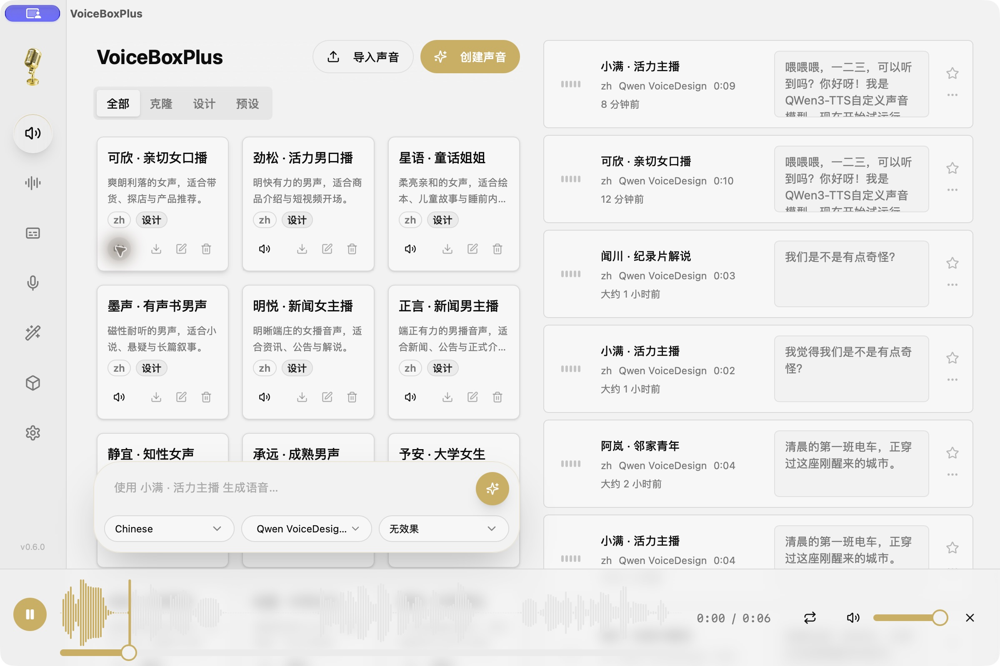
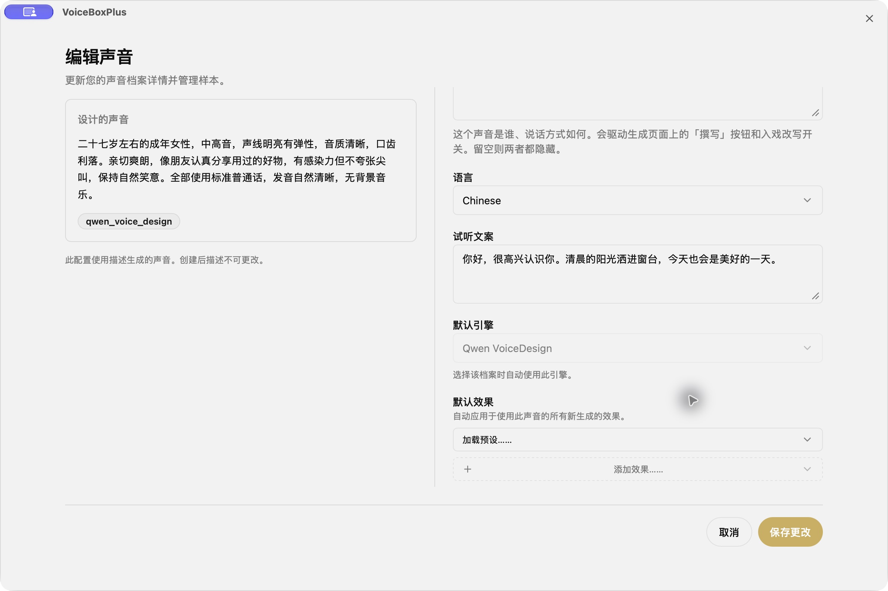
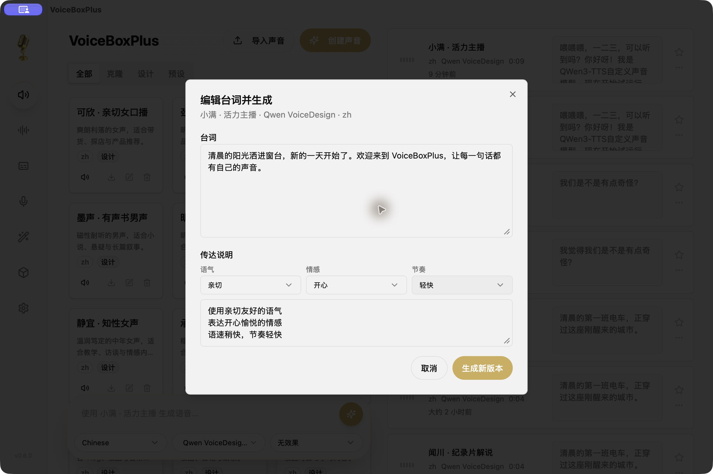

<!-- 与英文首页互链，并明确二开来源、真实功能和本地验证范围。 -->
# VoiceBoxPlus

**本地运行的桌面 AI 配音工作室：设计音色、试听声音、调整表达、迭代台词。**

[English](README.md) · 简体中文

VoiceBoxPlus 基于 Jamie Pine 与社区开发的 **[Voicebox](https://github.com/jamiepine/voicebox)** 二次开发，沿用 Tauri 桌面端与 Python 后端，重点完善 Qwen VoiceDesign 音色设计和中文配音工作流。本项目为独立社区分支，并非 Voicebox 官方版本。



## 新增与改进

| 功能 | 使用方式 |
| --- | --- |
| 设计音色 | 用自然语言描述声音，保存为可重复使用的音色档案。 |
| 独立试音 | 添加或编辑音色时设置试听文案，保存后生成专属试音；卡片上的试听按钮直接播放该样本，无需查找历史配音。 |
| 主播模板 | 提供 16 份中文音色描述，覆盖男女、老人、小孩、学生、新闻、有声书、童话和商品口播。 |
| 表达预设 | 语气、情感、节奏分别选择，可组合使用并保留手写说明；生成界面与编辑台词界面均支持。 |
| 台词修订 | 修改已有配音的台词并生成新版本，保留原始音频，可切换版本。 |
| 音色筛选 | 全部／克隆／设计／预设分类；选中音色不会改变卡片顺序。 |
| 桌面体验 | 修复悬浮编辑框背景透明，以及关闭播放器后再次播放时波形消失的问题。 |

### 描述你想要的声音

点击「创建声音」，选择设计模式，填写音色描述和试听文案。试音生成后，可直接在音色卡片上试听。



### 调整表达，迭代台词

通过语气、情感、节奏预设组合传达说明，也可以直接手写。已有配音可在历史菜单中选择「编辑台词并生成」；成功后保存为新版本，原始音频仍可使用。



## 从源码运行桌面 App

本分支已在 **Apple Silicon macOS** 本地验证。上游包含 Windows、Linux 支持，但本分支的修改尚未在这些平台完成验证。以上截图均来自 Tauri 桌面 App。

准备 Python 3.12、Bun、Rust、Just 和 [Tauri 平台依赖](https://v2.tauri.app/start/prerequisites/)。

```bash
git clone https://github.com/badboy-tian/VoiceBoxPlus.git
cd VoiceBoxPlus
just setup
```

在一个终端启动后端（macOS/Linux）：

```bash
backend/venv/bin/python -m backend.main --host 127.0.0.1 --port 17594
```

另一个终端启动桌面端：

```bash
just dev-frontend
```

本分支使用 **17594** 端口。继承的 `just dev`、`bun run dev:server` 快捷命令仍使用上游端口，请使用上述启动方式。首次使用模型需要联网下载，首次生成也可能因加载模型而较慢。

完成依赖安装后，构建桌面安装包：

```bash
just build
```

上游发布的安装包不包含本项目改动。本 README 不承诺本分支已有签名安装包；请使用本仓库源码，以及后续在本仓库发布的构建产物。

## 导入主播模板

后端运行时执行：

```bash
backend/venv/bin/python scripts/seed-designed-voices.py --url http://127.0.0.1:17594
```

脚本读取 [音色描述目录](presets/designed-voices.zh.json)，追加音色并排队生成试音。同名档案会跳过，重复执行不会覆盖你调整过的音色。模板是设计描述，不是随仓库附送的录音；实际声音由本地模型生成，不保证每次推理获得完全相同的声音身份。

已关闭上游自动更新源，避免官方 Voicebox 安装包覆盖本分支。

## 已有数据与升级

数据库升级在原 SQLite 数据库中追加字段，不清空重建。迁移现有安装前，请备份数据库及音频目录。为兼容此前的 Voice Design 桌面版本，应用标识继续使用 `sh.voicebox.app.voicedesign`，显示名称改为 VoiceBoxPlus 不会迁移数据目录。

macOS 桌面版本的数据位于 `~/Library/Application Support/sh.voicebox.app.voicedesign/`。源码运行的后端可能使用另一目录；需要复用已有数据时，通过 `--data-dir /path/to/data` 指向原数据库及音频资源目录。其他目录中的上游原版数据不会自动导入。

## 开发验证

```bash
bun run --cwd app typecheck
bun test scripts/instruct-presets.test.ts
backend/venv/bin/python -m pytest backend/tests/test_revisions.py backend/tests/test_voice_preview.py -q
```

Python 测试使用独立测试数据库和模拟模型推理，验证试音隔离与修订保留逻辑，不代表音质评测。更多继承文档见 [开发文档](docs/content/docs/developer/setup.mdx) 和 [后端说明](backend/README.md)，其中部分名称和端口仍沿用上游。

## 致谢与许可

本项目基于 **[Jamie Pine 与社区的 Voicebox](https://github.com/jamiepine/voicebox)**。感谢上游提供桌面工作室、模型集成和本地音频基础设施，感谢 Qwen 团队开源 Qwen3-TTS。

沿用 [MIT 许可证](LICENSE)，保留原始版权声明。模型权重及第三方依赖各自遵循其许可证，本仓库许可证不替代这些许可。
