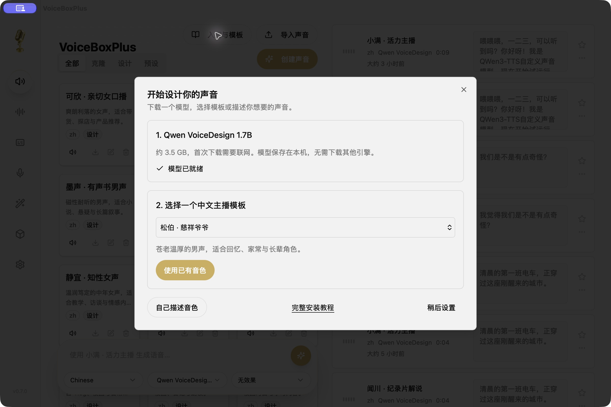
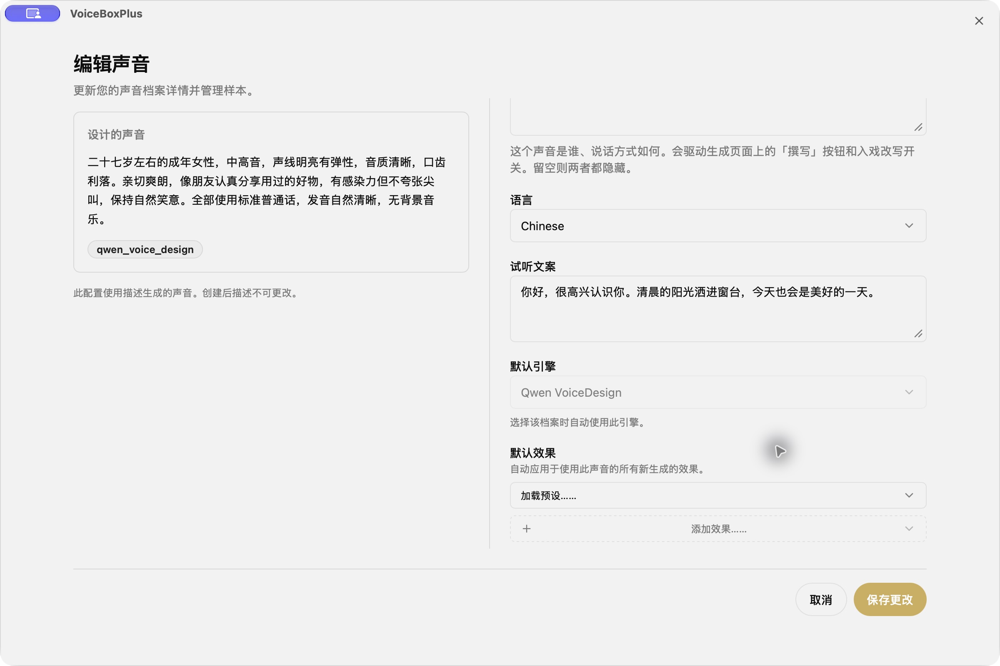
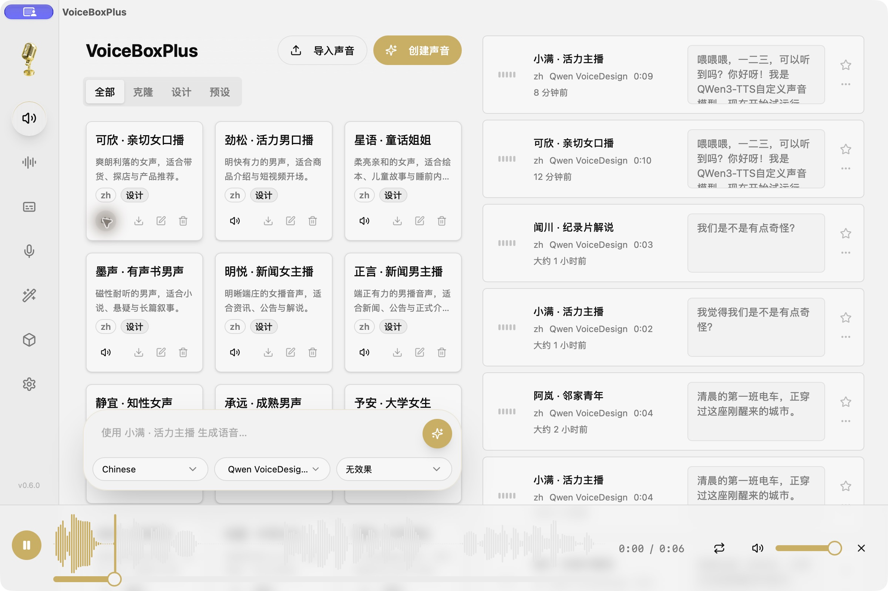
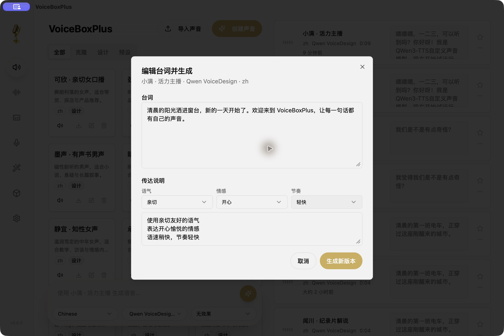

# Install VoiceBoxPlus and design your first voice

[简体中文](getting-started.zh-CN.md) · [Home](../README.md)

## 1. Install the desktop app

Download an installer from [Releases](https://github.com/badboy-tian/VoiceBoxPlus/releases/latest).

| Device | Installer | Install |
| --- | --- | --- |
| Apple Silicon Mac (M1 or newer) | `VoiceBoxPlus-macos-arm64.dmg` | Open the DMG and drag the app to Applications |
| Intel Mac | `VoiceBoxPlus-macos-x64.dmg` | Open the DMG and drag the app to Applications |
| Windows 10/11 x64 | `VoiceBoxPlus-windows-x64.exe` | Run the installer; install WebView2 if prompted |
| Ubuntu 22.04+ / compatible Debian x64 | `VoiceBoxPlus-linux-x64.deb` | `sudo apt install ./VoiceBoxPlus-linux-x64.deb` |

The installers include a compiled Python backend. You do not need Python, Bun, Rust, or a compiler. Model weights are downloaded separately. Allow enough disk space and RAM: the 3.5 GB model download size is not its memory requirement.

This community release is not Apple-notarized or Windows Authenticode-signed. Download from this repository and compare the included SHA-256 checksum. If macOS blocks the app, use the operating system’s Privacy & Security → Open Anyway flow. Review Windows prompts and the source before proceeding; do not disable system security protections.

## 2. Download the right model

**Quick start** opens automatically for an empty voice library. Reopen it any time using the button on the main screen.

Download **Qwen VoiceDesign 1.7B** (about 3.5 GB). The guide shows progress and errors with a retry action. The **Models** page also manages downloads and cache location.

For text-based voice design, you need only `Qwen/Qwen3-TTS-12Hz-1.7B-VoiceDesign`.

| Goal | Model |
| --- | --- |
| Design a new voice from a description | Qwen VoiceDesign 1.7B |
| Use Qwen’s fixed preset speakers | Qwen CustomVoice |
| Clone a voice from reference audio | Qwen3-TTS Base |

The first download needs access to Hugging Face. If it fails, check network access and free disk space, then retry. Once the model cache is complete, speech generation runs locally without a cloud speech API.

## 3. Try a presenter template

Quick start includes 16 Chinese voice descriptions: adult men and women, seniors, children, students, news presenters, audiobook narrators, storytellers, and product presenters.

Select one and choose **Add voice and generate preview**. Only that voice is added and its preview is generated locally. If its name already exists, use the existing profile without overwriting it. The templates contain descriptions, not the developer’s private recordings or bundled audio.

When the preview is ready, use the speaker button on its voice card to audition it.

## 4. Describe your own voice

Choose **Describe your own voice**, or **Create voice → Design**. Enter a name, voice description, and preview script, then save.

Try age, pitch, texture, personality, and language, for example:

> An adult woman in her thirties, medium pitch, warm and clear with a little natural breathiness. Friendly and unhurried, like sharing everyday stories with a friend. Speak standard English without background music.

The description determines vocal characteristics; the preview script determines the fixed sample’s words. Edit the preview script and save to regenerate it. An existing design description is currently immutable; create another profile for a different design. Generative output varies, so a template does not guarantee a perfectly fixed speaker identity.

## 5. Generate speech

Select a voice, type a script, and expand delivery instructions. Combine tone, emotion, and pace presets, add your own instructions if needed, and generate.

Qwen uses natural-language delivery instructions. Tags such as `[laugh]` from other engines are not universal Qwen commands, and this fork does not provide a general SSML parser.

## 6. Revise a recording

Open a history item’s menu and choose **Edit script and generate**. Update the words or delivery, then generate a new version. The original audio stays available; a failed revision does not replace it.

## Troubleshooting

- **Slow first generation:** downloading and loading models takes time. This release bundles CPU PyTorch on Windows/Linux; Intel Macs can also be slow.
- **No template audio:** templates are descriptions. Download the model and generate a preview first. Check errors; edit and save the voice to prepare a failed preview again.
- **Stalled download:** check Hugging Face access, disk space, and the Models page error, then retry. Existing cache files can usually be reused.
- **Upgrading:** the `sh.voicebox.app.voicedesign` identifier and existing database are retained. Back up the database and audio first. Another stock upstream data directory is not automatically imported.
- **Permissions:** text-based voice design needs no microphone or system dictation permissions. Microphone access is needed only when recording a cloning sample.
