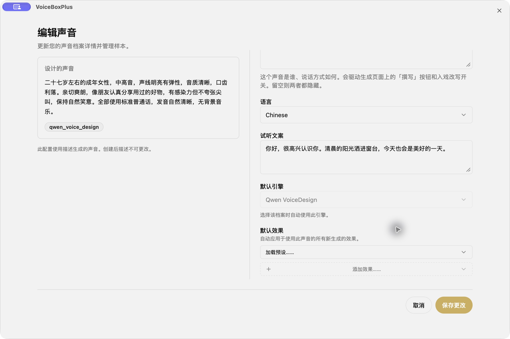
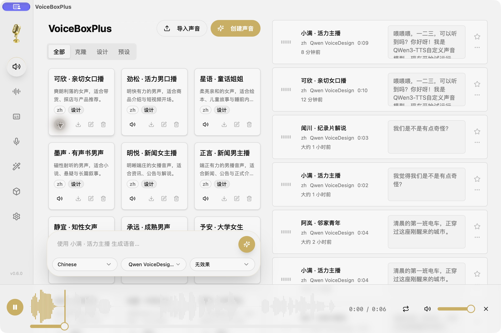
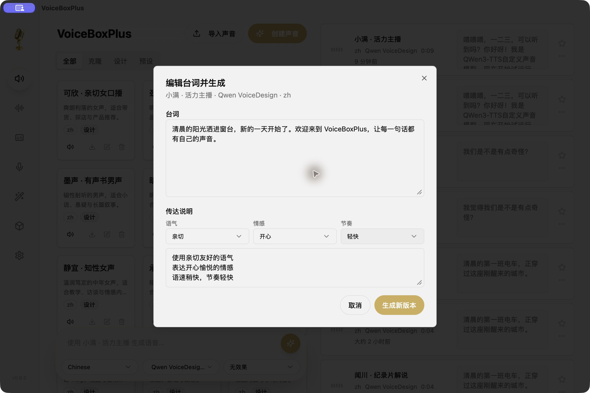

# VoiceBoxPlus 安装与音色设计教程

[English](getting-started.md) · [返回首页](../README.zh-CN.md)

## 1. 安装桌面 App

前往 [Releases](https://github.com/badboy-tian/VoiceBoxPlus/releases/latest)，下载与你设备对应的安装包：

| 设备 | 安装包 | 安装方式 |
| --- | --- | --- |
| M1/M2/M3/M4 等 Apple Silicon Mac | `VoiceBoxPlus-macos-arm64.dmg` | 打开 DMG，将 App 拖进「应用程序」 |
| Intel Mac | `VoiceBoxPlus-macos-x64.dmg` | 打开 DMG，将 App 拖进「应用程序」 |
| Windows 10/11 x64 | `VoiceBoxPlus-windows-x64.exe` | 运行安装程序；需要 WebView2，缺失时由安装器提示安装 |
| Ubuntu 22.04+ / 兼容 Debian x64 | `VoiceBoxPlus-linux-x64.deb` | 运行 `sudo apt install ./VoiceBoxPlus-linux-x64.deb` |

安装包已经编译并包含后端，不需要安装 Python、Bun、Rust。模型权重不包含在安装包中。需要网络下载模型，以及足够的磁盘与内存；不要把约 3.5 GB 的模型下载大小当作运行内存需求。

本社区版本没有 Apple 公证或 Windows 开发者证书签名。请从本仓库下载，核对 Release 附带的 SHA-256 校验和。如果 macOS 阻止打开，可到「系统设置 → 隐私与安全性」使用系统提供的「仍要打开」；Windows 可查看提示中的发布者和来源后决定是否继续，不需要关闭系统安全保护。

## 2. 下载设计音色需要的模型

首次进入空音色库时会自动打开「入门与模板」。以后也能在主界面点击同名按钮重新打开。

点击 **Qwen VoiceDesign 1.7B → 下载模型**。约需下载 3.5 GB，进度会直接显示在引导中；失败会显示原因并提供重试。也可到左侧「模型」管理下载、删除或查看存储位置。

设计音色只需要 `Qwen/Qwen3-TTS-12Hz-1.7B-VoiceDesign`，无需下载全部引擎。VoiceDesign、CustomVoice 和 Base 是不同模型，名称相似但不能互相替代：

| 需求 | 模型 |
| --- | --- |
| 根据文字描述设计新音色 | Qwen VoiceDesign 1.7B |
| 使用 Qwen 固定预设说话人 | Qwen CustomVoice |
| 根据参考录音克隆声音 | Qwen3-TTS Base |

首次下载需要能连接 Hugging Face。若下载失败，先检查磁盘空间和网络连接，在「模型」页面重试；可配置自定义模型缓存目录。模型缓存完整后，本地配音不需要云端语音 API。

## 3. 从主播模板开始

「入门与模板」内提供 16 份中文模板，覆盖男女主播、爷爷奶奶、小孩、中学生、大学生、新闻播报、有声书、童话与商品口播。

选择一个模板，点击「添加音色并生成试音」。App 会创建音色并生成固定试听，只处理你选中的模板，不会一口气生成全部音色。同名档案已存在时，可以直接使用已有音色，不覆盖你的调整。

试音就绪后，点击音色卡片的喇叭按钮试听。新用户没有开发者电脑里的录音；这些模板是随 App 提供的文字描述，声音和试听由你自己的电脑生成。

## 4. 自己描述音色

点击「自己描述音色」，或「创建声音 → 设计」。填写名称、音色描述和试听文案，保存后等待试音完成。

音色描述可以按「年龄感 + 音高与音质 + 说话气质 + 语言」组织，例如：

> 三十岁左右的成年女性，中音，声音温润清晰，带少量自然气声。像朋友在轻松分享生活，说话亲切从容，使用标准普通话，无背景音乐。

描述决定声音特征，试听文案决定固定样本读什么。试音可在编辑音色时修改并重新生成。当前已创建的设计描述不可直接修改；想换一种声音时请新建音色。生成模型有随机性，描述模板不是保证每次完全一致的说话人身份。

## 5. 生成第一段配音

选中音色，在下方输入台词并展开传达说明。分别选择语气、情感、节奏，也可以自己补充自然语言说明，然后生成。

Qwen 的表达控制使用自然语言说明。不要将 `[laugh]` 等其他引擎的标签当作 Qwen 通用控制符，本项目也没有提供通用 SSML 解析。

## 6. 修改已有配音

在历史配音的菜单中选择「编辑台词并生成」，修改台词和表达预设，点击「生成新版本」。原始音频保留；新版本成功后可以切换版本。生成失败不会覆盖原音频。

## 常见问题

- **首次很慢：** 下载和加载大模型需要时间。Windows/Linux 本次安装包包含 CPU 推理运行时；Intel Mac 也可能较慢。
- **有模板但听不到：** 模板不附带预录音，必须下载模型并生成试听。失败时检查提示，编辑并保存音色可重新准备试音。
- **下载不动：** 检查 Hugging Face 连通性、磁盘和模型页错误信息后重试，已下载的缓存文件通常可复用。
- **升级后数据还在吗：** 本项目继续使用 `sh.voicebox.app.voicedesign` 标识与原数据库；升级前仍建议备份数据库和音频目录。上游原版的另一数据目录不会自动导入。
- **需要麦克风权限吗：** 单纯文字设计和配音不需要；录音克隆时才需要。听写到其他 App 的辅助功能权限也不是设计音色的前置条件。
